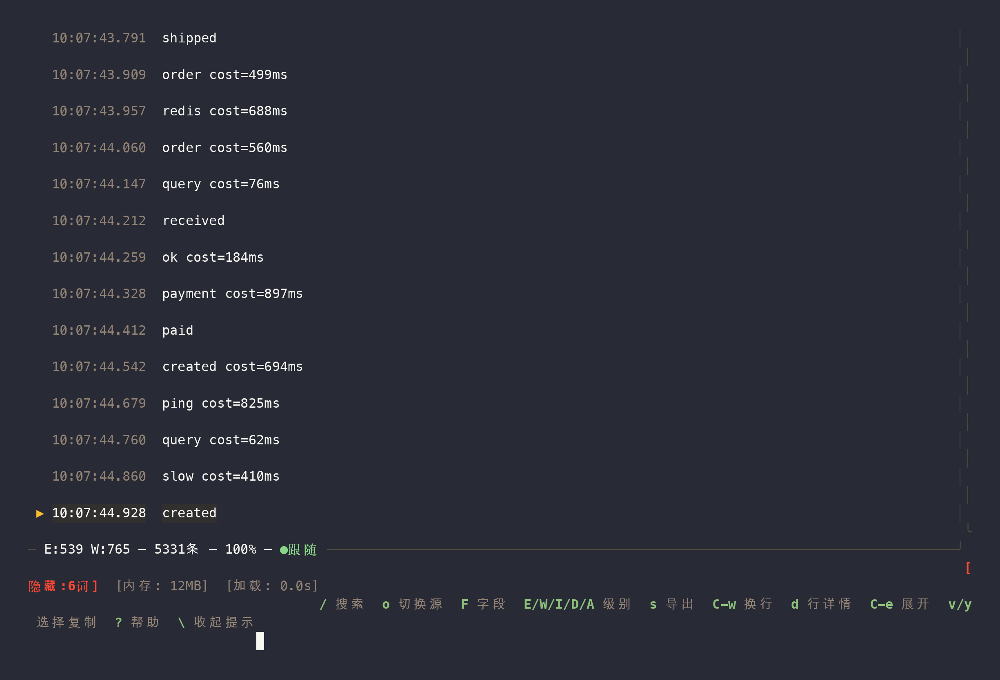
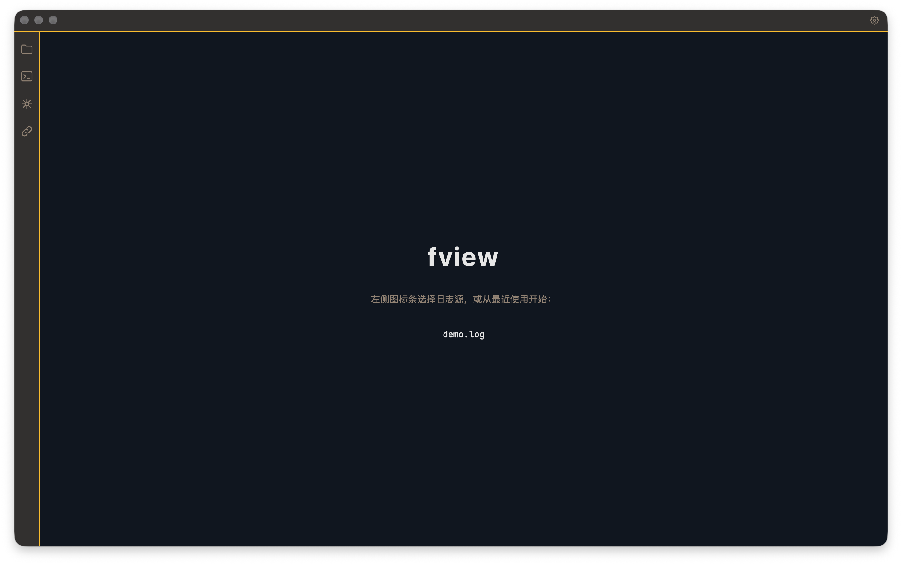
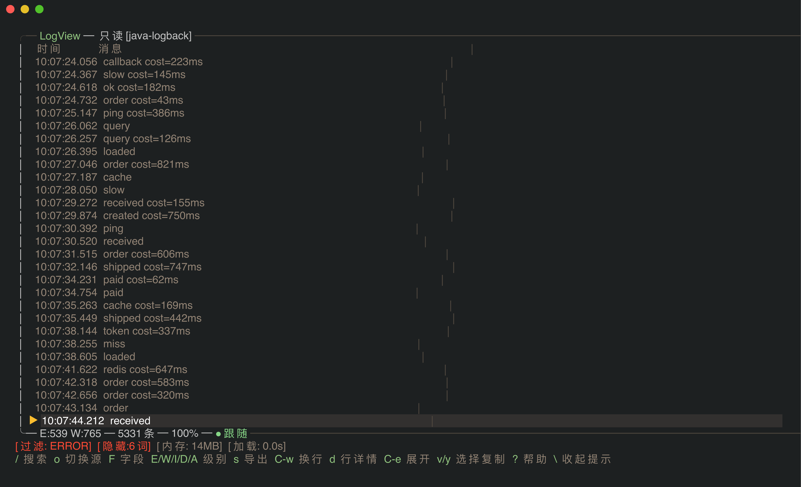
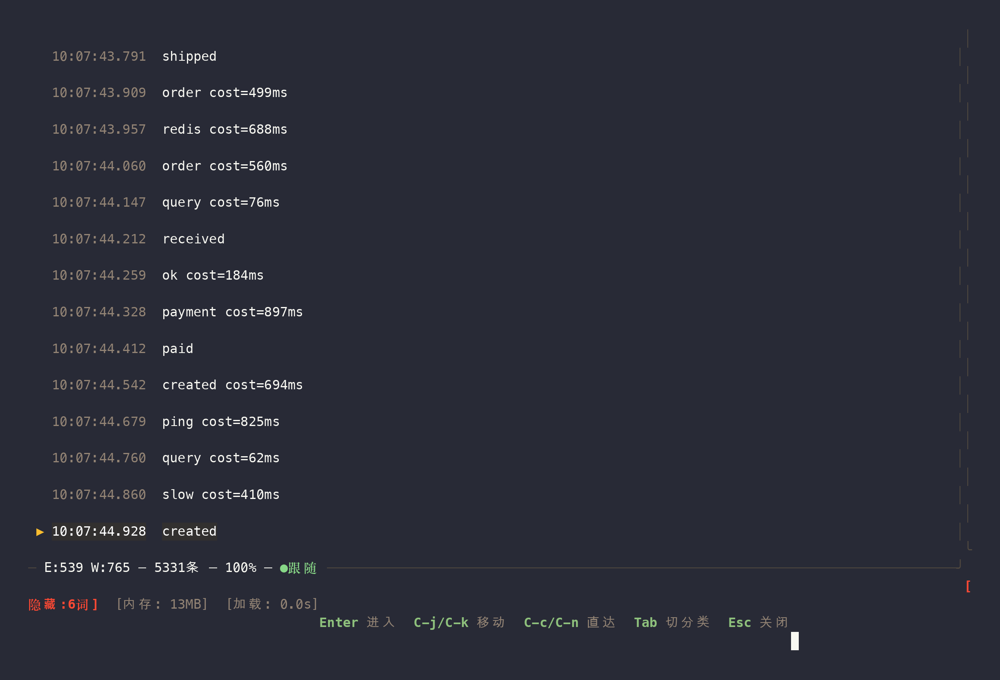
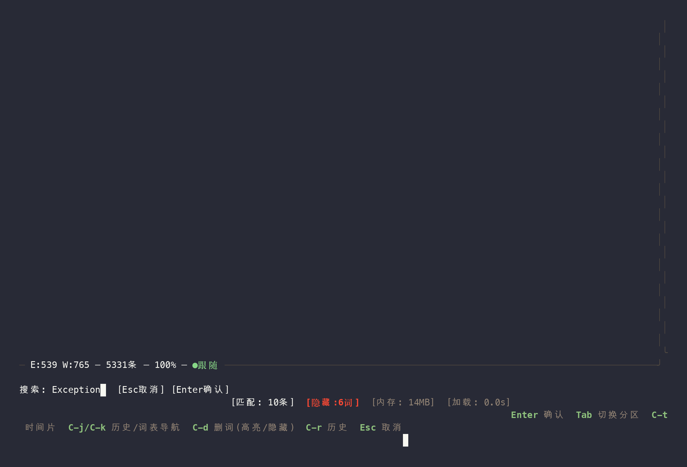
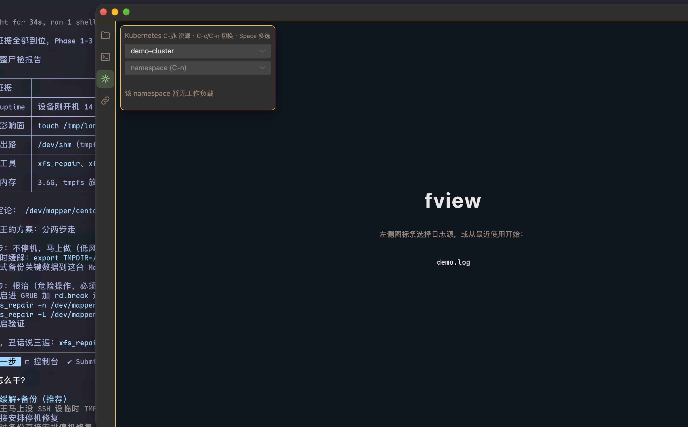

# LogView

**Terminal & macOS desktop log viewer** — tail local, SSH & Kubernetes logs with real-time search, filtering and highlighting. A fast `kubectl logs` alternative, written in Go.

一个项目,两种形态:**`logview`** 终端 TUI(跨平台)与 **`fview`** macOS 桌面版(多标签窗口)。双端共享同一内核——解析规则、搜索语法、主题、快捷键完全一致,混用零迁移。

<p>


</p>

<details>
<summary>更多截图</summary>

**TUI(终端)**

| 级别过滤(`E`) | 行详情面板(`d`) |
|---|---|
|  |  |

| 源选择器(`o`) | 搜索弹窗(`/`) |
|---|---|
|  |  |

**fview(桌面)**

| 源面板·连接管家(`q`) | 搜索弹窗(`/`) |
|---|---|
|  |  |

</details>

## Use Cases

- **`kubectl logs` alternative** — multi-resource Kubernetes log aggregation (stern-style)
- Tail logs from multiple SSH hosts in one terminal
- Reach intranet logs through FRP tunnels
- Read gzip logs directly; load 1GB files in seconds
- Auto-detect java-logback / JSON log formats
- Prefer a window? **fview** runs the same engine in a native macOS app with tabs

---

## 通用能力

> 双端共享 logcore 内核:以下能力 TUI 与 fview 完全一致,同一份 `rules.yaml`、同一套快捷键。

### 日志源

| 源 | 说明 |
|------|------|
| 本地文件 | 含 `.gz` 归档直接打开,按内容自动解压 |
| SSH 远程 | 主机候选(`ssh_hosts` + `~/.ssh/config`),密钥/密码/跳板全支持,远端 `.gz` 走服务器端解压管道 |
| FRP 隧道 | 已存 frp(stcp) 连接一键直达,隧道自动建立,其余同 SSH |
| Kubernetes | Pod / Deployment / StatefulSet;多资源聚合(stern 式),不同来源可不同解析规则 |
| stdin 管道 | 任意命令输出直接进查看器(TUI:`kubectl logs -f ... \| logview pipe`) |

### 搜索语法

支持关键词、字段匹配、布尔运算(`AND`/`OR`/`NOT`,大小写不敏感)、括号分组、引号、时间范围。**裸词默认全行匹配**(`message:` 显式限定消息字段),其它字段用 `field:value`。

```
JF350                            裸关键词(全行)
level:ERROR                      level 字段精确匹配
traceId:abc123 thread:exec-3     多字段 AND(相邻词默认 AND)
ERROR OR WARN                    OR 匹配
(ERROR OR WARN) AND timeout      括号分组
message:"hello world"            引号匹配含空格的值
level:ERROR NOT timeout          NOT 排除
```

#### 时间范围 `time:`

不写日期默认**今天**;全部按绝对时刻比较(跨天不歧义);非法值红字报错,不静默降级。搜索弹窗内 `C-t` 打开时间快捷片(最近5分钟/今天/昨天等一键插入)。

```
time:>09:00                      今天 09:00 之后(9:00 前导零宽容)
time:>=15:00                     含边界(cron 整点触发行不丢)
time:<10:00:30                   秒级精度
time:>-10m                       相对此刻 10 分钟前(-2d/-1h30m 复合时长)
time:-1h                         简写(负号开头默认 >)
time:>2026-08-26                 指定日期 00:00 之后
time:>2026-08-26T09:00:30        完整时间戳(RFC3339 风格,_ 为别名)
time:10:00..11:00                闭区间(含两端)
time:10:00..11:00 OR time:13:00..14:00    多时段
level:ERROR AND time:>-30s       与其它条件自由组合
```

> 无时区标记的时间戳一律按**本机时区**解释——日志里看到什么时间,就用什么时间搜。容器 UTC 日志而本机 +8 时可临时 `TZ=UTC logview ...` 对齐。无时间字段的行不参与任何 time 条件;无日期时间戳(`HH:mm:ss.SSS`)按当日时分窗口比较。

字段:`message` `source` `traceId` `thread` `logger`(包含匹配)、`level`(精确)、`time`(范围)。

### 过滤 / 高亮 / 上下文混入

- 级别过滤:`E` 仅 ERROR / `W` ERROR+WARN / `I` 去 DEBUG / `D` 全部 / `A` 取消
- 高亮 `C-h`(多色)、隐藏 `C-x`(逗号分隔多词);`C-r` 历史(高亮/隐藏按频次排序、跨会话留存、按源隔离)
- 上下文混入 `+N`/`-N`:过滤/搜索激活时触发行旁混入原始流上下文(暗色+`┆` 标记,多锚累积,`Esc`/`--` 关闭)
- 堆栈折叠:Java 多行堆栈自动折叠为 `(N lines)`,`C-e` 展开
- 标记跳转:`m` 标记当前行、`'` 打开标记列表浮层(`C-j`/`C-k` 选择,Enter 跳转居中);`S` 统计面板(级别占比)

### Vim 导航与复制

`j/k/g/G/H/M/L`、`zt/zz/zb`、`C-d/C-u/C-f/C-b`、scrolloff、数字前缀(`10j`、`5G`,上限 1000);字符级光标 `h/l/w/b/e/0/$/^`;可视选择 `v`(字符)/`V`(行)后 `y` 复制;`yy` 复制整行。

### 主题

配色取自各主题官方 palette(iTerm2-Color-Schemes),`theme: <名称>` 直接生效,`theme_colors` 逐项微调,双端同步。

| 主题 | 风格 | 主题 | 风格 |
|------|------|------|------|
| `dark` | 默认深色 | `light` | 默认浅色 |
| `dracula` | Dracula 紫 | `gruvbox-light` | Gruvbox 暖浅 |
| `tokyo-storm` | Tokyo Night 蓝紫 | `tokyo-day` | Tokyo Day 蓝浅 |
| `gruvbox` | Gruvbox 暖深 | `solarized-light` | Solarized 经典浅 |
| `solarized-dark` | Solarized 经典深 | `one-half-light` | One Half 灰浅 |
| `kanagawa` | Kanagawa 墨底浮世绘 | `rose-pine-dawn` | Rosé Pine 米纸 |
| `everforest` | Everforest 绿灰柔和 | `ayu-light` | Ayu 极简浅 |
| `rose-pine-moon` | Rosé Pine 夜紫 | | |
| `monokai-pro` | Monokai Pro 紫灰 | | |
| `synthwave-84` | Synthwave '84 蒸汽波 | | |

### 配置 rules.yaml

配置目录 `~/.config/logview/`,首跑自动生成完整注释版,双端共享。核心字段速览:

```yaml
# patterns: 可复用的正则片段,rules 中用 {name} 引用
patterns:
  time: '(?P<time>\d{4}-\d{2}-\d{2} \d{2}:\d{2}:\d{2}[.,]\d{3})'

# rules: 解析规则,按顺序匹配,每个来源选第一个命中的
rules:
  - name: java-logback
    pattern: '{time} \[{thread}\] \[{traceId}\] {level}\s+{logger} - {message}'

# theme: 配色主题(17 个内置见上表;theme_colors 逐项覆盖颜色)
theme: dracula

# hides: 默认隐藏包含这些关键词的日志行
# hides:
#   - health check

# fields: 字段显示/隐藏;width 为固定列宽
fields:
  - name: time
    visible: true
    width: 12
  - name: message
    visible: true
```

<details>
<summary>📜 完整 rules.yaml 模板与配置项说明</summary>

```yaml
# patterns: 可复用的正则片段,在 rules 中用 {name} 引用
patterns:
  time: '(?P<time>\d{4}-\d{2}-\d{2} \d{2}:\d{2}:\d{2}[.,]\d{3})'
  hmsTime: '(?P<time>\d{2}:\d{2}(?::\d{2})?(?:[.,]\d{1,3})?)'
  thread: '(?P<thread>[^\]]+)'
  traceId: '(?P<traceId>[^\]]+)'
  level: '(?P<level>\w+)'
  simpleLevel: '(?P<level>TRACE|DEBUG|INFO|WARN|ERROR|FATAL)'
  logger: '(?P<logger>\S+)'
  message: '(?P<message>.*)'

# rules: 解析规则,按顺序匹配,每个来源只选第一个命中的
rules:
  - name: java-logback
    pattern: '{time} \[{thread}\] \[{traceId}\] {level}\s+{logger} - {message}'
  # 无日期时间戳的简单日志(HH:mm:ss[.SSS] 级别 消息):time: 搜索按当日时分窗口
  - name: simple-time-level
    pattern: '{hmsTime}\s+{simpleLevel}\s+{message}'
  - name: json-log
    pattern: '(?P<raw>.*)'
    parse: json
  - name: plain-text
    pattern: '{message}'

# history: -f 模式默认加载的尾行数
history: 5000

# theme: 配色主题(dark 系: dark/dracula/tokyo-storm/gruvbox/solarized-dark/kanagawa/everforest/rose-pine-moon/monokai-pro/synthwave-84
#                  light系: light/gruvbox-light/tokyo-day/solarized-light/one-half-light/rose-pine-dawn/ayu-light)
theme: dark

# theme_colors: 覆盖主题颜色(十六进制)
# theme_colors:
#   level.error: "#FF0000"
#   highlight: "#FFFF00"

# hides: 默认隐藏包含这些关键词的日志行
# hides:
#   - health check
#   - heartbeat

# fields: 字段显示/隐藏;width 为固定列宽(超长截断,logger 自动缩写,时间列超宽保时分秒)
fields:
  - name: time
    visible: true
    width: 12
  - name: source
    visible: true
  - name: level
    visible: true
  - name: thread
    visible: false
    width: 10
  - name: traceId
    visible: false
    width: 12
  - name: logger
    visible: false
    width: 20
  - name: message
    visible: true

# keybindings: 自定义快捷键(预留字段,当前版本未生效,按键固定见快捷键表)
# keybindings:
#   search: "/"
#   search-next: "n"
```

| 字段 | 说明 | 默认值 |
|------|------|--------|
| `patterns` | 可复用正则片段,rules 中用 `{name}` 引用 | 无 |
| `rules` | 解析规则列表,按顺序匹配 | 内置 java-logback / json / plain-text |
| `history` | `-f` 模式默认尾行数 | `5000` |
| `theme` | 配色主题,17 个内置 | `dark` |
| `theme_colors` | 覆盖主题颜色(十六进制) | 无 |
| `fields` | 字段显示控制,隐藏后搜索仍可用;`width` 固定列宽 | 全部显示 |
| `hides` | 默认隐藏关键词 | 无 |
| `ssh_hosts` | 源选择器 SSH 常用主机候选(与 ~/.ssh/config 合并) | 无 |
| `keybindings` | 自定义快捷键(预留,未生效) | 见快捷键表 |

**规则匹配机制**:每个来源独立匹配,第一条命中即锁定;优先结构化规则,50 行未命中降级 `plain-text`;多资源聚合时不同来源可用不同规则。

</details>

---

## 安装

### TUI · logview(跨平台终端)

```bash
brew tap Miragefl/logview
brew install logview
```

<details>
<summary>Linux 二进制 / 国内镜像 / 源码编译</summary>

```bash
# Linux x86_64 — 下载预编译二进制
curl -LO https://github.com/Miragefl/logview/releases/latest/download/logview_linux_amd64.tar.gz
tar xzf logview_linux_amd64.tar.gz && sudo mv logview /usr/local/bin/

# ARM64
curl -LO https://github.com/Miragefl/logview/releases/latest/download/logview_linux_arm64.tar.gz

# 国内镜像(Gitee)
# https://gitee.com/Mtok/logview/releases — 下载对应架构包

# 或从源码编译(需要 Go >= 1.26)
go install github.com/Miragefl/logview@latest
```

</details>

### 桌面 · fview(macOS)

```bash
brew tap Miragefl/logview
brew install --cask fview
```

Apple Silicon / Intel 双架构,检测更新走应用内「关于」页。

---

## 快捷键(双端统一)

按 `?` 查看内置帮助;完整键表点击展开。标注「TUI」/「fview」的为单端专属,其余双端一致。

<details>
<summary>⌨️ 完整快捷键表</summary>

### 导航

| 按键 | 功能 | | 按键 | 功能 |
|------|------|-|------|------|
| `k` / `↑` | 上移 | | `j` / `↓` | 下移 |
| `g` | 顶部 | | `G` | 底部 |
| `C-u` | 上半页 | | `C-d` | 下半页 |
| `C-b` | 上翻页 | | `C-f` | 下翻页 |
| `H` / `M` / `L` | 屏顶/屏中/屏底 | | `zt`/`zz`/`zb` | 当前行置顶/居中/置底 |
| `10j` `5G` | 数字前缀(count 上限 1000) | | `Esc` | 清 count / 关闭弹窗 |

### 字符光标与复制(vim 式)

| 按键 | 功能 |
|------|------|
| `h` / `l` | 光标左移 / 右移(`w`/`b`/`e` 按词,`0`/`$`/`^` 行首尾) |
| `v` / `V` | 字符选择 / 行选择 |
| `y` | 复制选区 / 当前行(`yy` 整行) |

### 搜索

| 按键 | 功能 |
|------|------|
| `/` | 打开搜索弹窗(历史/词表/操作三分区,`[命中 N 条]` 实时反馈) |
| `n` / `N` | 下一个 / 上一个匹配 |
| `C-r` | 搜索/高亮/隐藏框内打开对应历史列表 |
| `Tab` | 搜索弹窗内切换分区,`C-j`/`C-k` 导航,`C-t` 时间片,`C-d` 删词 |
| `Esc` | 清除搜索 |

> 输入防抖:连续打字不做全量过滤(任意大小文件都流畅),敲**空格**、**停手约 1 秒**或 **Enter** 时生效。

### 过滤与高亮

| 按键 | 功能 |
|------|------|
| `E` | 仅 ERROR(`W` ERROR+WARN / `I` 去 DEBUG / `D` 全部 / `A` 取消) |
| `C-h` | 高亮关键词(逗号分隔,10 色轮换粗体下划线) |
| `C-x` | 隐藏关键词 |
| `+N` / `-N` | 上下文混入(`Esc`/`--` 关闭,多锚累积) |

### 源与面板

| 按键 | 功能 |
|------|------|
| `o` / `q` | 打开源选择器/源面板(TUI 选择器内再按 `q` 关闭;fview 再按循环分组 本地→SSH→K8s→FRP,`Q` 反向) |
| `C-1..9` | fview 切换 tab ⌘N 同效 |
| `C-a` | 面板内新增(SSH 主机 / FRP 连接) |
| `C-e` | 面板内编辑回填 |
| `C-d` | 面板内删除(SSH 主机 / FRP 连接) |
| `C-w` | 切换自动换行(fview 的 ⌘W 走原生菜单关 tab) |

### 标记与工具

| 按键 | 功能 |
|------|------|
| `m` / `'` | 标记当前行 / 标记列表浮层 |
| `S` | 统计面板(级别数量占比) |
| `F` | 字段显示设置 |
| `d` | 行详情(完整字段+消息全文+原始行,`C-j/C-k` 联动,`y` 复制) |
| `C-e` | 展开 / 折叠堆栈 |
| `#` | 切换行号;`\` 收起提示栏;`C` 清屏 |
| `s` | 导出日志(当前筛选/全部缓冲,原始/JSON)——TUI |
| `C-c` | 退出(TUI);fview 为 ⌘Q |

</details>

---

## TUI 专属 · logview

### 快速开始

```bash
# Kubernetes
logview k8s deploy/app                      # 查看日志
logview k8s -f deploy/app                   # follow 模式
logview k8s -200f deploy/app                # 最后 200 行 + 追踪
logview k8s -n prod deploy/app              # 指定 namespace
logview k8s -c uat-context deploy/app       # 指定 context(不改全局 kubeconfig)
logview k8s -n a deploy/api -n b deploy/bk  # 跨 namespace 多资源

# 本地文件
logview tail -f /var/log/app.log            # follow 模式
logview tail -200f /var/log/app.log         # 最后 200 行 + 追踪
logview file /var/log/app.log               # 只读模式
logview file app1.log app2.log              # 多文件只读
logview tail /var/log/app.log.gz            # gzip 归档直接打开

# 大文件(秒开)
logview file big.log                        # 尾读:默认只载入末尾 10 万行,1G 日志秒开
logview file big.log --buffer-size 500000   # 载入末尾 50 万行
logview file big.log --all                  # 全量驻留(heavy: ~0.4KB 内存/行)

# 恢复会话
logview tail -R -f /var/log/app.log         # 恢复搜索、过滤、光标位置

# 管道
kubectl logs -f deploy/app | logview pipe
echo "hello" | logview                      # 自动检测 stdin

# 远程服务器日志(SSH + pipe,搜索/高亮/过滤全可用)
ssh user@server "tail -f /var/log/app.log" | logview
ssh user@server "gunzip -c /var/log/app.log.gz" | logview   # 远端解压,网络只传解压后行

# 管道 DSL(grep 预过滤后进 TUI,仍可搜索/高亮)
logview './park.log | grep 123'
logview 'tail -100f /var/log/app.log | grep -E "ERROR|WARN"'

logview version                             # 版本信息
logview --config /path/to/config ...        # 指定配置目录
```

裸 `logview`(无子命令)在终端中直接打开源选择器;本机无 `kubectl` 时自动隐藏 K8s tab。

<details>
<summary>源选择器细节与命令补全</summary>

**SSH 密码认证**:需要密码的主机连接失败时自动弹出密码输入框(掩码显示),Enter 自动重连;密码仅存内存不落盘。主机不可达时错误以 ERROR 行显示在日志区。

**目录过滤**:本地/SSH 目录浏览时输入即过滤(`.` 开头显示隐藏文件);输入绝对路径 + Enter 直达。

**K8s 多选**:`Space` 勾选多个 deploy/pod,Enter 合流打开;K8s tab 内 `C-c` 直达 context 层、`C-n` 直达 namespace 层。

```bash
# 命令补全(bash / zsh / fish)
logview completion zsh > ~/.zfunc/_logview
logview completion bash > /etc/bash_completion.d/logview
logview completion fish > ~/.config/fish/completions/logview.fish
```

</details>

---

## 桌面专属 · fview

**fview** 是 LogView 的桌面版(Go + Wails 原生窗口,macOS):多标签页同时挂多个日志源,图形化连接管家,与 TUI 共享全部配置——解析规则 `rules.yaml`、最近文件与关键词热点、FRP 连接,两边混用零迁移。

- **多 tab 会话**:本地文件 / SSH / FRP 隧道 / K8s 日志并行打开,`C-1..9` 秒切,tab 栏数字角标提示
- **连接管家**:左侧图标条 本地/SSH/K8s/FRP 四面板,面板内直接打字过滤(子序列匹配,`hardware` 输 `hde` 亦命中),`C-a` 新增 / `C-e` 编辑 / `C-d` 删除
- **K8s 日志合流**:deployment/statefulset 自动展开副本 pod 合流查看(stern 式),Space 多选资源 Enter 合流、⌘Enter 各开,行首 pod 名区分来源
- **鼠标 + vim 双模**:点击定位、拖选字符级复制(松手即复制),键盘流 vim 键全量保留
- **字段列交互**:双击字段复制原始值,光标词/选区一键带入搜索、高亮、隐藏
- 搜索/高亮/隐藏统一弹窗(`[命中 N 条]` 实时反馈),主题、字号、字体可调

---

## 功能概览

| 功能 | 说明 |
|------|------|
| 多数据源 | k8s Pod/Deployment、本地文件(含 `.gz`)、SSH/FRP 远程、stdin 管道,多资源聚合 |
| follow 模式 | `-f` 追踪新日志,`-200f` 简写加载尾行数(TUI) |
| 大文件 | 1G/664 万行加载 15s,默认尾读秒开;5G mmap 零拷贝(TUI) |
| 智能解析 | 自动识别 JSON、Logback 等格式,patterns 模板复用 |
| 搜索语法 | `field:value`、`AND/OR/NOT`、`time:` 时间范围,输入防抖 |
| 高亮与隐藏 | `C-h` 多色高亮,`C-x` 隐藏关键词,历史按频次跨会话 |
| 上下文混入 | `+N/-N` 过滤行旁混入原始流上下文,多锚累积 |
| 级别过滤 | `E`/`W`/`I`/`D`/`A` 快速切换 |
| 行详情面板 | `d` 完整字段 + 消息全文 + 原始行,JSON 自动美化 |
| 堆栈折叠 | Java 多行堆栈自动折叠,`C-e` 展开 |
| Vim 全家桶 | 导航/滚动/数字前缀/字符光标/可视选择复制 |
| 主题 | 17 个内置主题,`theme_colors` 逐项覆盖,双端同步 |
| 双端共享 | rules.yaml、关键词热点、FRP 连接、快捷键完全一致 |
| 命令补全 | bash / zsh / fish(TUI) |

---

## License

MIT
